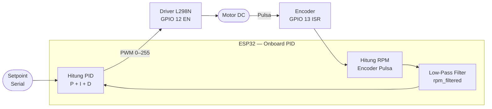
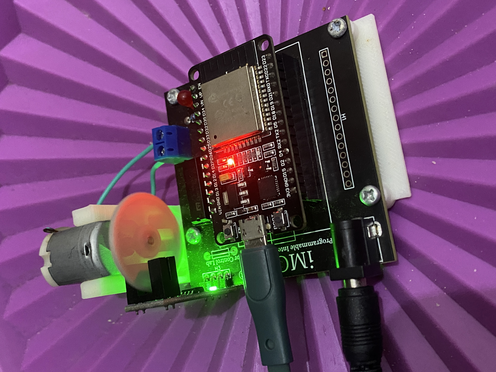

# Modul 1 — PID Arduino (Onboard Controller)

## Tujuan

Mengimplementasikan algoritma kendali PID (Proportional–Integral–Derivative) secara langsung di dalam mikrokontroler ESP32 (onboard) untuk mengatur kecepatan putar motor DC agar sesuai dengan setpoint yang ditentukan. Seluruh komputasi PID dilakukan di firmware tanpa bantuan komputer eksternal.

---

## Alat & Bahan

| Komponen | Keterangan |
|---|---|
| Kit iMCLab | Board ESP32 terintegrasi driver motor L298N + encoder |
| Motor DC | Terpasang pada kit iMCLab |
| Encoder piringan | 2 lubang, terpasang pada poros motor (GPIO 13) |
| Driver Motor L298N | Terintegrasi di kit (IN1=GPIO 27, IN2=GPIO 26, EN=GPIO 12) |
| Kabel USB | Koneksi ke laptop untuk upload firmware & Serial Monitor |
| Arduino IDE 2.3.6 | Board: DOIT ESP32 DEVKIT V1, Baud: 115200 |

---

## Cara Kerja

### Diagram Alur Sistem



### Penjelasan Alur

1. **Baca RPM** — interrupt `RISING` pada GPIO 13 mencacah pulsa encoder; RPM dihitung dari jumlah pulsa dibagi jumlah lubang (2) per satuan waktu (1 detik).
2. **Filter** — RPM dihaluskan dengan low-pass filter untuk meredam noise encoder.
3. **Hitung PID** — error = setpoint − RPM terfilter, lalu hitung komponen P, I (dengan anti-windup), D.
4. **Output PWM** — hasil PID di-*clamp* ke 0–255 dan dikirim via `ledcWrite` ke Enable pin L298N (GPIO 12, channel 1, 30 kHz, 8-bit).

### Kode Kunci

```cpp
// Inisialisasi PWM motor
ledcSetup(pwmChannel, freq, resolution);  // ch1, 30kHz, 8-bit
ledcAttachPin(enable1Pin, pwmChannel);    // GPIO 12

// ISR encoder
void IRAM_ATTR isr() { rev++; }

// Hitung RPM tiap 1 detik
float rotations = (float)(current_rev - last_rev_count) / holes;
rpm = rotations / (time_elapsed / 60000.0);

// Hitung PID
float error = setpoint - rpm_filtered;
P = Kp * error;
I += Ki * error * dt;
I = constrain(I, -100, 100);   // anti-windup
D = Kd * (error - prev_error) / dt;
float output = constrain(P + I + D, 0, 255);
ledcWrite(pwmChannel, (int)output);
```

### Parameter PID

| Parameter | Nilai |
|---|---|
| Setpoint | 5000 RPM |
| Frekuensi sampling | 1 Hz |
| PWM frekuensi | 30.000 Hz |
| Resolusi PWM | 8-bit (0–255) |

---

## Hasil Eksperimen

### Serial Monitor — Kondisi Stabil di Setpoint 5000 RPM

Output Serial Monitor menampilkan data real-time tiap iterasi PID: waktu sampling, jumlah pulsa, RPM terukur, RPM terfilter, dan komponen P/I/D beserta PWM yang dikirim ke motor.


**Analisis:** Sistem berhasil mempertahankan RPM aktual mendekati setpoint 5000 RPM. Output PWM stabil di kisaran **176/255 (~69%)**, menunjukkan sistem sudah konvergen. Komponen I mendominasi (I≈176), P dan D kecil — sistem sudah di steady-state.

### Hardware iMCLab



Modul ESP-WROOM-32 pada kit iMCLab, motor DC terpasang di bagian bawah, dan LED indikator menyala menandakan firmware aktif berjalan.

---

## Kesimpulan

Algoritma PID berhasil diimplementasikan secara onboard di ESP32. Sistem mampu mengatur kecepatan motor DC mendekati setpoint 5000 RPM dengan output PWM yang stabil. Keunggulan modul ini adalah **latensi rendah** karena komputasi berlangsung langsung di mikrokontroler tanpa ketergantungan pada komputer eksternal. Keterbatasannya adalah parameter PID harus diatur ulang melalui Serial dan tidak dapat dipantau dari jarak jauh.
