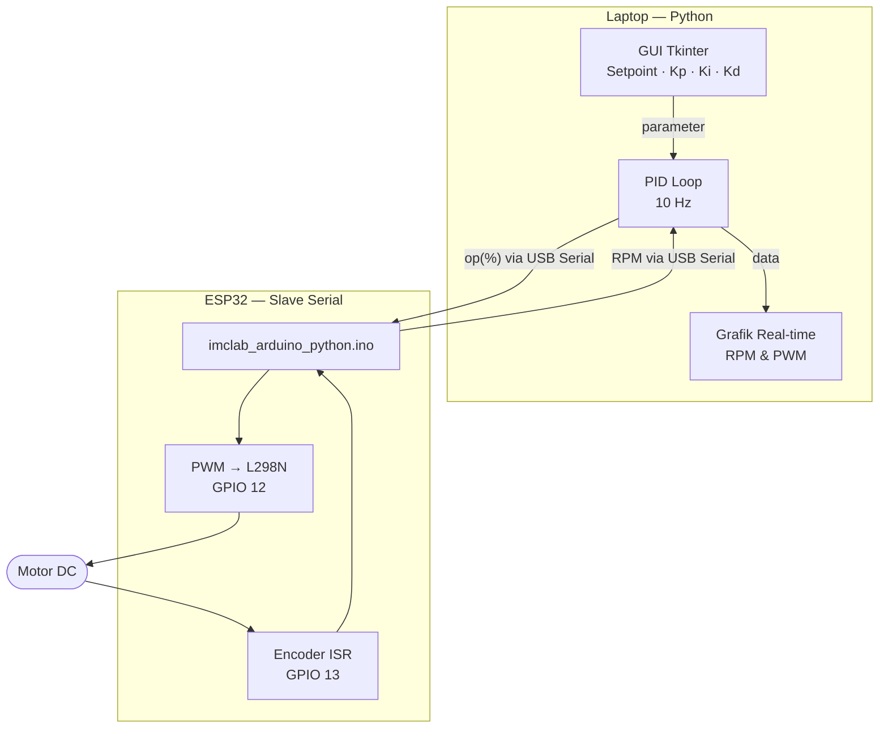
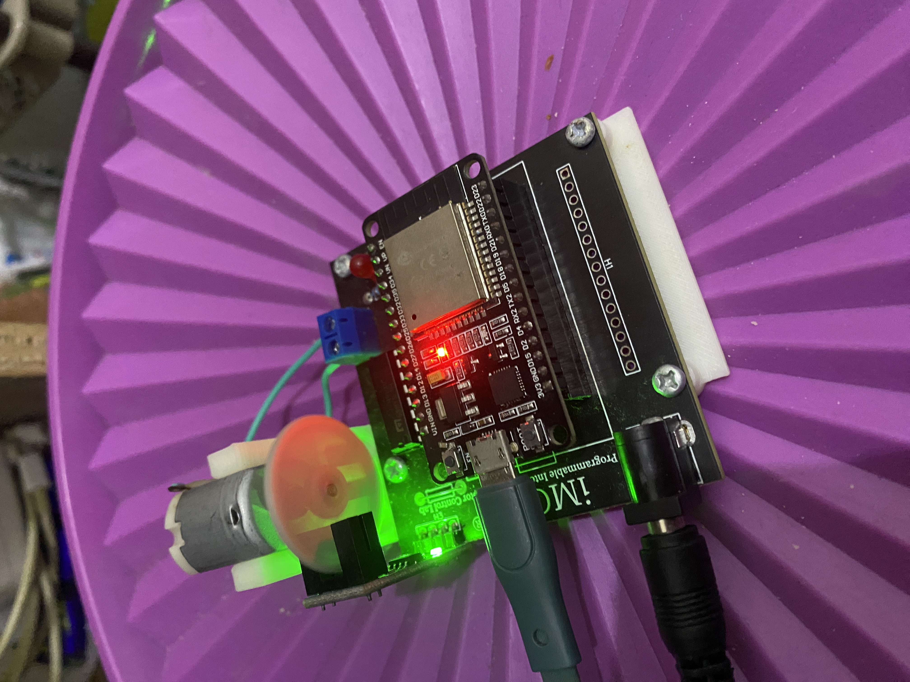

# Modul 2 — PID Python (Serial + GUI Tkinter)

## Tujuan

Memindahkan komputasi algoritma PID dari mikrokontroler ke komputer (Python), sehingga ESP32 hanya berfungsi sebagai *slave* serial yang membaca sensor encoder dan mengeksekusi perintah PWM. Seluruh logika kendali, visualisasi real-time, dan penyesuaian parameter dilakukan melalui antarmuka GUI berbasis Python (Tkinter + Matplotlib).

---

## Alat & Bahan

| Komponen | Keterangan |
|---|---|
| Kit iMCLab | ESP32 + driver L298N + encoder |
| Laptop (macOS) | Menjalankan script `pid_python.py` |
| Kabel USB | Komunikasi serial ESP32 ↔ laptop (115200 baud) |
| Firmware ESP32 | `imclab_arduino_python.ino` — slave serial, pin 27/26/12/13 |
| Python 3.13 | Library: `pyserial`, `numpy`, `matplotlib`, `tkinter` |
| `imclab.py` | Driver serial iMCLab: auto-detect port via USB VID/PID |
| `pid_python.py` | Aplikasi GUI PID + visualisasi grafik real-time |

---

## Cara Kerja

### Diagram Alur Sistem



### Penjelasan Alur

Firmware ESP32 hanya menerima perintah teks via Serial (`op <nilai>` untuk set PWM, `RPM` untuk baca kecepatan). Python membaca RPM, menghitung PID, lalu mengirim output kembali ke motor — siklus ini berjalan pada **10 Hz** (sampling tiap 100 ms). Grafik diperbarui setiap 500 ms.

### Kode Kunci Python

```python
# Koneksi auto-detect port ESP32
self.lab = imclab.iMCLab()   # deteksi VID/PID: 10C4:EA60 / 1A86:55D4

# Loop PID di background thread (10 Hz)
error = self.setpoint - current_rpm
P = self.kp * error
integral += error * dt
integral = max(-100, min(100, integral))  # anti-windup
I = self.ki * integral
D = self.kd * (error - prev_error) / dt if dt > 0 else 0
output = max(0.0, min(100.0, P + I + D))

self.lab.op(output)   # kirim PWM (0–100%) ke ESP32 via serial
```

### Parameter PID

| Parameter | Nilai |
|---|---|
| Kp | 1.5 |
| Ki | 0.5 |
| Kd | 0.05 |
| Setpoint | 1375 RPM |
| Sampling rate | 10 Hz |
| Update grafik | 500 ms |

---

## Hasil Eksperimen

### GUI Tkinter — Visualisasi Real-time

Antarmuka menampilkan dua grafik: (atas) respons sistem RPM aktual vs setpoint, dan (bawah) usaha kontrol output PWM. Panel kiri menyediakan kontrol setpoint (slider), parameter Kp/Ki/Kd, dan status koneksi.


**Analisis:** Grafik RPM aktual (merah) menunjukkan respons osilasi terhadap setpoint (hijau putus-putus ~1375 RPM). Output PWM (biru) berfluktuasi antara 0–100%, mencerminkan usaha kontrol yang agresif. Status koneksi: **Connected** — `imclab.py` berhasil mendeteksi port ESP32 secara otomatis.

### Hardware iMCLab




Piringan encoder (oranye/merah) terpasang pada poros motor. LED merah pada board menandakan firmware slave sedang aktif. Kabel USB terhubung ke laptop untuk komunikasi serial.

---

## Kesimpulan

Pendekatan PID berbasis Python memberikan fleksibilitas tinggi: parameter Kp/Ki/Kd dapat diubah secara langsung via GUI tanpa perlu meng-*upload* ulang firmware. Visualisasi real-time memudahkan observasi respons sistem. Keterbatasannya adalah ketergantungan pada koneksi fisik kabel USB dan tidak dapat dioperasikan dari jarak jauh.
