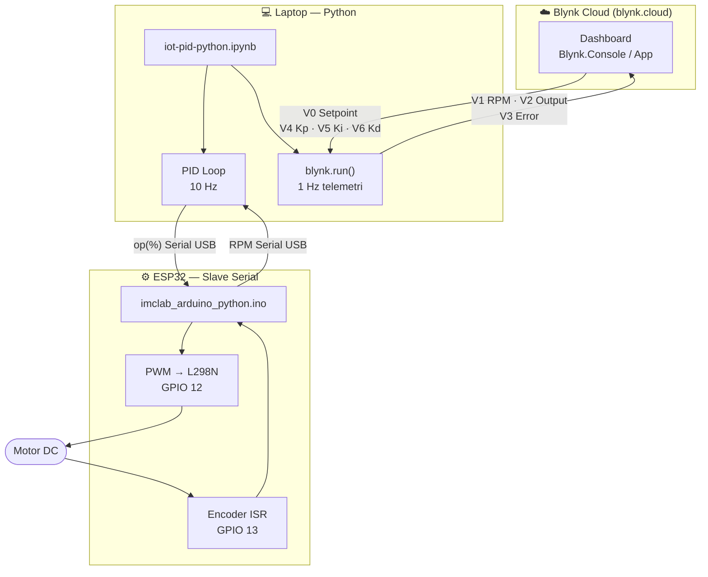
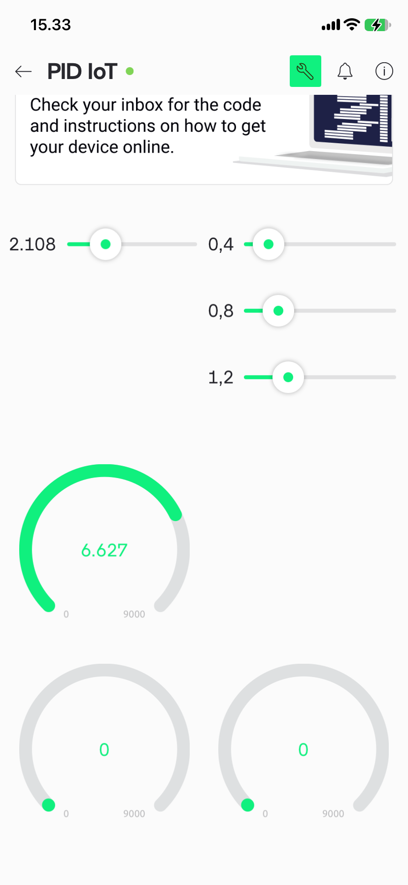

# Modul 4 — PID Blynk (Python + IoT Dashboard Blynk)

## Tujuan

Mengintegrasikan sistem kendali PID berbasis Python (Modul 2) dengan platform IoT Blynk, sehingga monitoring dan penyesuaian parameter dapat dilakukan dari mana saja melalui Blynk.Console (web) maupun aplikasi Blynk IoT (mobile). ESP32 tetap berperan sebagai slave serial; Python menjalankan PID sekaligus menjadi jembatan antara hardware dan cloud Blynk.

---

## Alat & Bahan

| Komponen | Keterangan |
|---|---|
| Kit iMCLab | ESP32 + L298N + encoder (firmware slave serial) |
| Laptop (macOS) | Menjalankan `iot-pid-python.ipynb` via Jupyter/VS Code |
| Kabel USB | Komunikasi serial ESP32 ↔ laptop |
| Jaringan WiFi + Internet | Laptop terhubung internet untuk akses Blynk.Cloud |
| Blynk IoT (blynk.cloud) | Template: "Quickstart Template" (TMPL60XTXooZG) |
| Python 3.13 | Library: `BlynkLib`, `imclab`, `numpy` |
| `iot-pid-python.ipynb` | Notebook: PID loop + Blynk virtual pin handlers |
| Blynk App (mobile) | Monitoring & kontrol parameter dari HP |

---

## Cara Kerja

### Diagram Alur Sistem



### Pemetaan Virtual Pin Blynk

| Pin | Nama | Arah | Fungsi |
|---|---|---|---|
| V0 | Setpoint | App → Python | Target RPM motor |
| V1 | RPM | Python → App | RPM aktual terukur |
| V2 | Output | Python → App | Output PID (% PWM) |
| V3 | Error | Python → App | Selisih setpoint − RPM |
| V4 | Kp | App → Python | Konstanta proporsional |
| V5 | Ki | App → Python | Konstanta integral |
| V6 | Kd | App → Python | Konstanta derivatif |

### Kode Kunci Python

```python
blynk = BlynkLib.Blynk(BLYNK_AUTH, server="blynk.cloud")

@blynk.VIRTUAL_WRITE(0)   # V0 — terima setpoint dari app
def v0_write_handler(value):
    global setpoint, integral
    setpoint = float(value[0])
    integral = 0.0   # reset anti-windup saat setpoint berubah

@blynk.VIRTUAL_WRITE(4)   # V4 — terima Kp dari app
def v4_write_handler(value):
    global Kp
    Kp = float(value[0])

# Kirim telemetri ke Blynk (1 Hz)
blynk.virtual_write(1, round(current_rpm, 0))    # RPM → V1
blynk.virtual_write(2, round(output_signal, 1))  # Output → V2
blynk.virtual_write(3, round(error, 1))          # Error → V3

blynk.run()   # event loop Blynk (non-blocking)
```

---

## Hasil Eksperimen

### Konfigurasi Datastreams di Blynk.Console

Tujuh datastream dikonfigurasi pada template "Quickstart Template" (ID: TMPL60XTXooZG), masing-masing memetakan virtual pin V0–V6 ke parameter sistem PID.


### Dashboard Blynk.Console — Device Online

Device "PID IoT" berhasil terhubung ke Blynk.Cloud (status: **Online**). Dashboard menampilkan kontrol setpoint (5000 RPM), parameter Kp=0.8, dan gauge RPM aktual menunjukkan **3070 RPM** — sistem sedang dalam proses mengejar setpoint.


### Blynk App Mobile — Kontrol Parameter

Tampilan aplikasi Blynk IoT di smartphone menunjukkan slider parameter (Kp=2.108, Ki=0.4, Kd=0.8, Kd=1.2) dan gauge RPM aktual sebesar **6.627 RPM**. Titik hijau di header "PID IoT" mengonfirmasi status device Online.



### Notebook Berjalan — Output Terminal

VS Code menampilkan `iot-pid-python.ipynb` Cell 5 sedang berjalan (aktif >1 menit 17 detik). Output terminal menampilkan log PID per iterasi: waktu, setpoint (5000), RPM aktual, dan output sinyal — memperlihatkan sistem bekerja saat Kp diubah secara dinamis dari app.


---

## Kesimpulan

Integrasi Blynk berhasil menambahkan lapisan IoT pada sistem PID Python. Parameter Kp, Ki, Kd, dan setpoint dapat diubah secara real-time dari smartphone atau browser tanpa menyentuh kode, sementara data RPM, output, dan error dapat dipantau dari mana saja selama ada koneksi internet. Pendekatan ini menggabungkan fleksibilitas komputasi Python di laptop dengan kemudahan monitoring IoT berbasis cloud.
