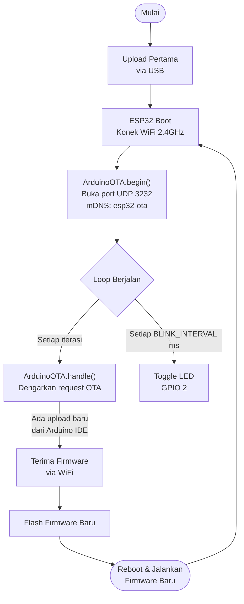
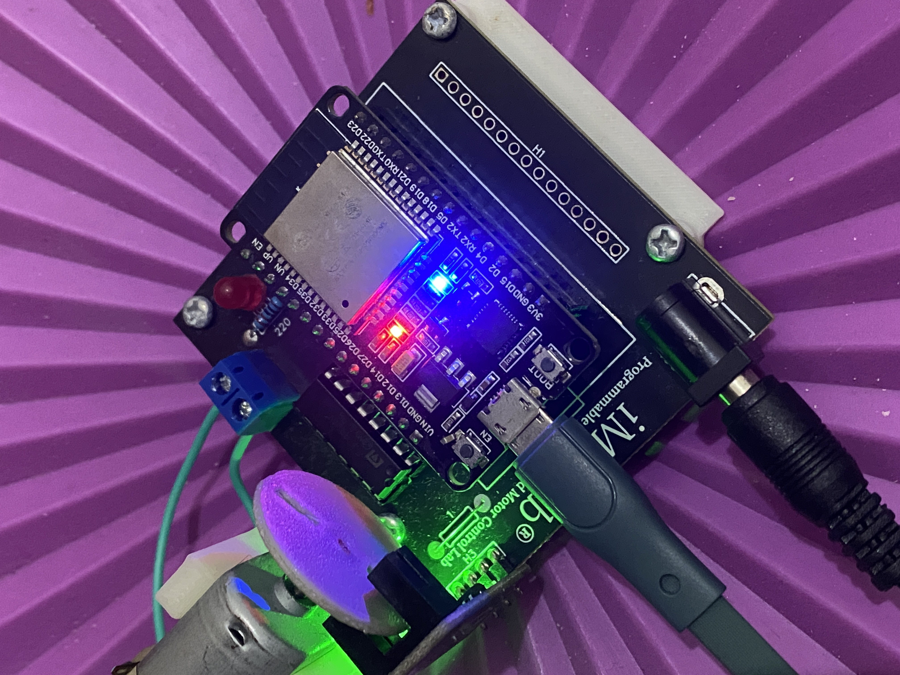

# Modul 3 — OTA Blink (Over-The-Air dengan ArduinoOTA)

## Tujuan

Mendemonstrasikan kemampuan pembaruan firmware ESP32 secara nirkabel (*Over-The-Air* / OTA) menggunakan library `ArduinoOTA` bawaan Arduino. Setelah firmware pertama di-upload via kabel USB, semua pembaruan berikutnya dapat dilakukan melalui jaringan WiFi lokal tanpa koneksi fisik ke board.

---

## Alat & Bahan

| Komponen | Keterangan |
|---|---|
| Kit iMCLab | ESP32 (DOIT ESP32 DEVKIT V1) |
| Jaringan WiFi 2.4 GHz | ESP32 dan laptop harus berada di jaringan yang sama |
| Arduino IDE 2.3.6 | Upload pertama via USB, selanjutnya via WiFi OTA |
| `OTA-Blink.ino` | Firmware: ArduinoOTA + blink LED GPIO 2 |
| Laptop (macOS) | IP laptop: 192.168.0.132, IP ESP32: 192.168.0.127 |

---

## Cara Kerja

### Diagram Alur Sistem



### Penjelasan Alur

Setelah firmware awal ter-upload via USB, ESP32 membuka port **UDP 3232** dan mendaftarkan diri ke jaringan via **mDNS** dengan hostname `esp32-ota`. Arduino IDE mendeteksi board sebagai *network port* dan dapat meng-upload firmware baru tanpa kabel. Proteksi password (`IoTOTA`) menjaga keamanan upload.

### Kode Kunci

```cpp
ArduinoOTA.setHostname("esp32-ota");
ArduinoOTA.setPassword("IoTOTA");

ArduinoOTA.onProgress([](unsigned int progress, unsigned int total) {
    Serial.printf("Progress: %u%%\r", (progress / (total / 100)));
});
ArduinoOTA.begin();

void loop() {
    ArduinoOTA.handle();   // selalu jalan — dengarkan request OTA

    // Demo blink LED GPIO 2
    if (millis() - last_toggle >= BLINK_INTERVAL) {
        last_toggle = millis();
        led_state = !led_state;
        digitalWrite(LED_BUILTIN, led_state);
    }
}
```

### Konfigurasi OTA

| Aspek | Nilai |
|---|---|
| Hostname mDNS | `esp32-ota` |
| Password OTA | `IoTOTA` |
| Port | UDP 3232 |
| IP ESP32 | 192.168.0.127 |

---

## Hasil Eksperimen

### Upload OTA Berhasil — 100% Done

Arduino IDE menampilkan progress upload firmware secara nirkabel dari 96% hingga 100% selesai. Board yang digunakan: **ESP32 Dev Module** via network port **192.168.0.127**.


**Analisis:** Firmware berhasil dikirim sepenuhnya via WiFi tanpa kabel USB. Port yang tampil di status bar: `ESP32 Dev Module on 192.168.0.127` — membuktikan koneksi OTA via network berhasil. Setelah upload selesai, ESP32 reboot otomatis dan menjalankan firmware baru.

### Hardware iMCLab



LED biru (indikator WiFi/status) dan LED merah menyala pada board iMCLab setelah firmware OTA berhasil dijalankan.

---

## Kesimpulan

ArduinoOTA memungkinkan pembaruan firmware ESP32 secara penuh melalui jaringan WiFi lokal. Ini sangat berguna untuk perangkat yang sudah terpasang di lapangan di mana akses fisik sulit. Keterbatasannya: OTA hanya berfungsi selama firmware aktif dan board konek ke WiFi — jika firmware crash, OTA tidak dapat digunakan. Modul ini menjadi fondasi untuk Modul 5 yang menggunakan OTA berbasis cloud (Blynk.Air).
