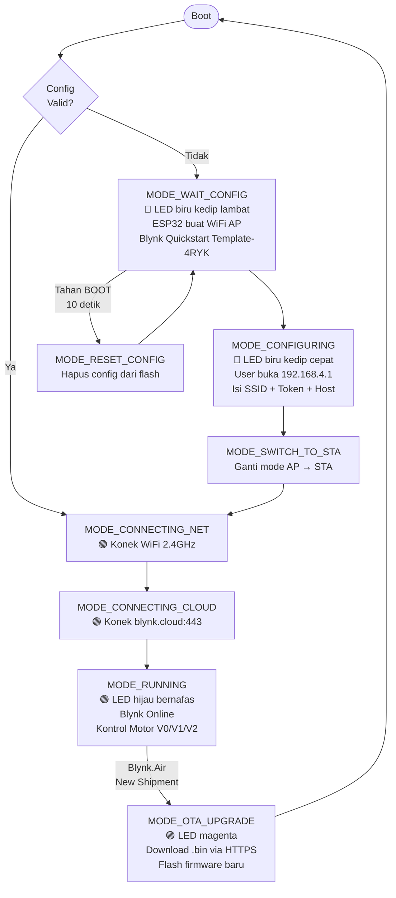
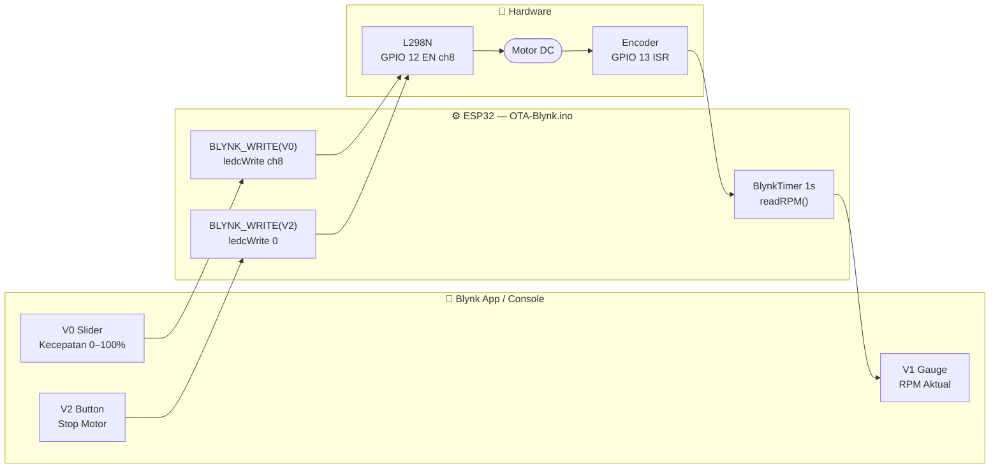
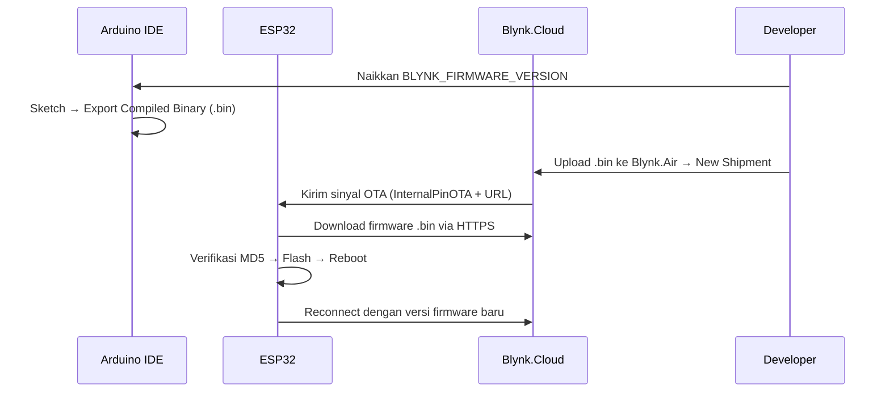

# Modul 5 — OTA Blynk (Blynk.Edgent + Blynk.Air)

## Tujuan

Mengintegrasikan OTA firmware ESP32 dengan platform Blynk secara penuh menggunakan **Blynk.Edgent** (framework provisioning WiFi otomatis) dan **Blynk.Air** (layanan OTA berbasis cloud Blynk). Berbeda dengan Modul 3 (ArduinoOTA via LAN), pada modul ini firmware dapat diperbarui dari mana saja melalui internet. Sekaligus ditambahkan kontrol motor DC via virtual pin Blynk.

---

## Alat & Bahan

| Komponen | Keterangan |
|---|---|
| Kit iMCLab | ESP32 + L298N + encoder (GPIO 27/26/12/13), LED GPIO 2 |
| Jaringan WiFi 2.4 GHz | Untuk ESP32 setelah provisioning |
| Arduino IDE 2.3.6 | Board: ESP32 Dev Module, Partition: Minimal SPIFFS |
| Blynk library v1.3.2 | Versi dengan Blynk.Edgent self-contained (9 header) |
| `OTA-Blynk.ino` + 9 header | Firmware utama + Edgent support files |
| Blynk.Console (blynk.cloud) | Template: "Quickstart Template" (TMPL60XTXooZG) |
| Browser / Blynk App | Provisioning via `http://192.168.4.1` |

---

## Cara Kerja

### Diagram State Machine Edgent (Provisioning + OTA)



### Diagram Kontrol Motor via Blynk



### Penjelasan Teknis

| Aspek | Detail |
|---|---|
| Provisioning | Blynk.Inject via WiFi AP (bukan BLE), web form 192.168.4.1 |
| Config storage | NVS (`Preferences "blynk"`) — persisten antar reboot & flash |
| LED indikator | LEDC channel 1 (high-speed timer) |
| Motor PWM | LEDC channel 8 (low-speed timer) — tidak konflik |
| Reset config | Tahan BOOT (GPIO 0) ≥ 10 detik → hapus NVS |
| OTA trigger | `BLYNK_WRITE(InternalPinOTA)` → download .bin dari URL Blynk.Air |

### Kode Kunci

```cpp
// Motor: PWM channel 8 (low-speed), terpisah dari LED indikator ch 1
ledcSetup(8, 30000, 8);
ledcAttachPin(enable1Pin, 8);  // GPIO 12

BLYNK_WRITE(V0) {   // slider kecepatan dari Blynk
    int duty = map(constrain(param.asInt(), 0, 100), 0, 100, 0, 255);
    ledcWrite(8, duty);
}

BLYNK_WRITE(V2) {   // tombol stop
    if (param.asInt()) ledcWrite(8, 0);
}

// Kirim RPM ke gauge Blynk (V1) tiap 1 detik
motorTimer.setInterval(1000L, readRPM);

void loop() {
    BlynkEdgent.run();   // state machine: provisioning + cloud + OTA
    motorTimer.run();
}
```

### Alur Update Firmware via Blynk.Air



---

## Hasil Eksperimen

### Reset Config & AP Provisioning Muncul

Serial Monitor menampilkan alur reset konfigurasi: setelah tombol BOOT ditahan 10 detik, config dihapus (`Resetting configuration!`), device masuk `WAIT_CONFIG`, dan AP `blynk.setup` aktif. Di panel WiFi macOS, AP **"Blynk Quickstart Template-4RYK"** terlihat dalam daftar jaringan.


### Form Provisioning di Browser (192.168.4.1)

Setelah laptop terhubung ke AP, browser membuka `http://192.168.4.1` dan menampilkan form konfigurasi: WiFi SSID, Password, Auth Token (32 karakter), Host (`blynk.cloud`), dan Port (`443`).


### Respons Berhasil — "Trying to connect..."

Setelah form disubmit, device merespons dengan JSON `{"status":"ok","msg":"Trying to connect..."}`, menandakan konfigurasi diterima dan disimpan ke flash NVS. ESP32 langsung beralih ke mode STA.


### Device Online di Blynk.Console

Device "PID IoT" muncul **Online** di Blynk.Console. Dashboard menampilkan Setpoint=1000, Kp=0.4, Ki=0.8, Kd=1.2. Indikator **Messages used: 1.3k of 100k** membuktikan komunikasi data antara ESP32 dan Blynk.Cloud sudah berlangsung.


---

## Kesimpulan

Blynk.Edgent + Blynk.Air memberikan solusi OTA yang lebih lengkap dibanding ArduinoOTA (Modul 3): provisioning WiFi tanpa hardcode kredensial, OTA via internet (bukan hanya LAN lokal), dan integrasi dashboard IoT untuk monitoring dan kontrol motor. Pemisahan LEDC channel motor (ch 8) dari LED indikator Edgent (ch 1) memastikan keduanya bekerja tanpa konflik. Keterbatasannya: ukuran binary lebih besar (perlu partition scheme "Minimal SPIFFS") dan memerlukan akun Blynk serta koneksi internet aktif.
